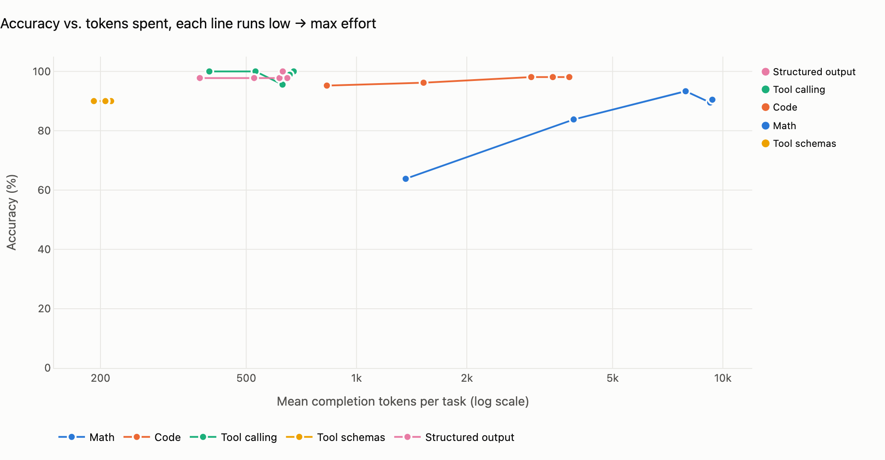

# Beam Effort Curve

How much reasoning effort does Reflection's [Beam-1.0-501B-A23B](https://huggingface.co/reflection/Beam-1.0-501B-A23B) need? This repo measures accuracy, output tokens and latency at all five `reasoning_effort` levels (`low`, `medium`, `high`, `xhigh`, `max`) on 125 tasks written after the model's knowledge cutoff, and ships the result as a drop-in wrapper that picks the level per request.

**Headline: use `high` for reasoning and `low` for everything else. That matches `max` accuracy (95.7%) with 64% of the output tokens.**



| Strategy | Accuracy | Mean output tokens | Tokens vs. `max` |
|---|---|---|---|
| fixed `medium` | 93.3% | 1,747 | 42% |
| fixed `high` | 95.5% | 3,368 | 80% |
| fixed `max` | 95.7% | 4,185 | 100% |
| **`high` for reasoning, `low` otherwise** | **95.7%** | **2,671** | **64%** |

The full write-up, including overthinking cases, a `preserve_thinking` ablation and API notes, is in [FINDINGS.md](FINDINGS.md).

## Using the wrapper

```bash
pip install git+https://github.com/dmartine/beam-effort-curve
```

```python
from openai import OpenAI
from beam_autoeffort import auto_effort, with_reasoning

client = auto_effort(OpenAI(base_url="https://api.reflection.ai/openai/v1", api_key="..."))

r = client.chat.completions.create(model="Beam-1.0-501B-A23B", messages=[{"role": "user", "content": "..."}])
print(client.last_effort)  # "high" for reasoning; "low" with tools, a JSON response format, or a code request
```

- The level is chosen from what is visible before the call: attached tools, a JSON `response_format`, and the prompt text. Requests it doesn't recognize are treated as reasoning and get `high`.
- An explicit `reasoning_effort` (keyword or `extra_body`) always wins.
- `with_reasoning(message)` builds the assistant turn to send back in multi-turn and tool-calling conversations. Reflection's API rejects an earlier assistant message without `reasoning_content`; the helper keeps it, reads it from either `reasoning_content` or `reasoning` depending on the provider, and falls back to a placeholder when there is none.
- The policy lives in [`beam_autoeffort/policy.json`](beam_autoeffort/policy.json). Pass `policy={...}` to override it.

## What was measured

| Category | Tasks | Grader |
|---|---|---|
| Math (25 core, 10 hard) | 35 | last `\boxed{}` answer, exact or symbolic match |
| Code (25 core, 10 hard) | 35 | model's code run against hidden tests in a sandboxed subprocess |
| Tool calling (20 core, 10 hard) | 30 | multi-turn agent loop with canned tool outputs; calls checked in order |
| Tool schemas | 10 | arguments against nested, union and enum-heavy schemas |
| Structured output | 15 | JSON Schema validation plus field-level accuracy |

Every task was written for this benchmark after Beam's June 30, 2026 knowledge cutoff, and each builder in [`tasks/build/`](tasks/build/) verifies its tasks before writing them (brute-force answers, reference solutions run against the tests, perfect transcripts replayed through the grader).

Runs: 3 samples per task and level (1 for hard math), temperature 0.7 and top_p 0.99 as on the model card, 32k max output tokens, Reflection's API, October 27 to November 1, 2026. 1,775 graded runs in total.

## Reproducing

```bash
python -m venv .venv && .venv/bin/pip install -r requirements.txt
cp .env.example .env   # add REFLECTION_API_KEY

python -m src.run --run-id full-2026-10-27 --samples 3 --token-budget 900000   # resumable; rerun to continue
python -m src.grade
python -m src.analyze      # summary.csv, overthinking.csv, charts
python -m src.router       # router_eval.csv, router_sweep.csv, router_policy.json
python -m src.export_space # copies results and the wrapper into space/
```

The run resumes from its results file, so a stopped or rate-limited run continues with the same command. `--token-budget` stops starting new calls after that many output tokens (Reflection's beta allows 1M per organization per day). `--backend ollama` runs against Ollama Cloud instead.

## Layout

```
beam_autoeffort/   drop-in wrapper and its policy (the pip package)
src/
  client.py        one chat() call for Reflection, Ollama Cloud and HF Inference Providers
  run.py           tasks x effort levels x samples, resumable, with a token budget
  graders/         math, code, tools, structured
  grade.py         grades raw rows into results/graded.parquet
  analyze.py       bootstrap CIs over tasks, overthinking cases, charts
  router.py        learns and cross-validates the per-request policy
  charts.py        Plotly figures (shared with the Space)
  export_space.py  prepares space/ for upload
space/             Gradio app: curves, router, overthinking, findings
tasks/             the 125 tasks (JSONL) and the builders that generate and verify them
```

## Related entries

Two other Build with Beam entries look at nearby questions and are worth reading alongside this one:

- [Beam Effort Atlas](https://huggingface.co/datasets/iarsalanshah/beam-effort-atlas) maps how higher effort runs out of a fixed completion budget and returns nothing. This repo's runaway generations at `xhigh` and `max` under a 32k cap are the same effect.
- [Forged Thoughts](https://huggingface.co/spaces/MjdMaz/forged-thoughts) tests what Beam does with false claims in its sent-back reasoning, using the same kind of code-word check as this repo's send-back probe.

## License

Apache 2.0. See [LICENSE](LICENSE).
